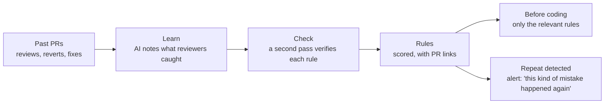

<div align="center">

# Pitfall

**Your AI coding assistant learns from your team's past code reviews — and stops repeating the same mistakes.**

[](https://github.com/paarths-collab/pitfall/actions/workflows/python-app.yml)


[](LICENSE)

</div>

---

## The problem

Reviewers keep catching the same things: *"add a timeout here"*, *"don't block the event loop"*, *"call this once, not in a loop"*.
Your AI assistant never read those reviews, so it makes the same mistakes again.

## What Pitfall does

Pitfall reads your repository's pull-request history, turns real reviewer feedback into short **rules with evidence**, and gives your assistant the right ones **before it writes code**. When a known mistake happens again, it tells you.



## How it works

1. **Learn from history.** Your assistant reads closed PRs (oldest first) through GitHub's official MCP and notes what reviewers caught: reverts, follow-up fixes, and change requests the author actually fixed.
2. **Check before it counts.** A fresh second pass verifies every proposed rule against the exact reviewer quote. Nothing is used until it is approved.
3. **Keep only real patterns.** The code — not the AI — decides what becomes a rule:

   | Level | When | Shown to the assistant? |
   | --- | --- | --- |
   | Candidate | seen once | no |
   | **Rule** | seen in 2 different PRs, or reverted once | yes |
   | **Must not repeat** | the same kind of mistake happened again after it became a rule | yes, first — and you get an alert |
   | Archived | no new evidence for a year | no |

   Plain opinions, self-reviews and bot comments are ignored. Rules raised by only one reviewer are marked as *reviewer preference*.
4. **Use the right rules.** Before coding, the assistant names the kinds of mistake its change involves and asks for the rules about its files and those kinds — at most 8, strongest first, each with a link to the PR it came from.
5. **Keep learning.** New PRs are processed the same way. If a known mistake shows up again, the rule gets stronger and you see: *"This type of mistake happened again (lesson L3, PR #57) — you may want to look at it."*

**Same kind of mistake, not just the same one.** Every rule has a general *principle* ("every outbound call needs a timeout") next to the specific case it came from, and belongs to one *mistake family* from a small fixed list (such as `missing-timeout` or `resource-leak`). So a missing timeout on a database call counts as the same kind of mistake as one on an HTTP call, even in another folder, and the rule is shown for both. See [how it works](docs/how-rules-work.md#mistake-families).

## Quick start

**1. Connect GitHub's official MCP** in your AI client ([setup guide](https://github.com/github/github-mcp-server)). Read-only access is enough.

**2. Install Pitfall** and add it to the same client:

```sh
pipx install git+https://github.com/paarths-collab/pitfall
```

```json
{
  "mcpServers": {
    "pitfall": { "command": "pitfall-mcp" }
  }
}
```

**3. Teach it your repo.** Run the prompt `learn_from_prs` with `repo: owner/name`. Repeat until it says it is caught up (or schedule it daily). For a big backlog, `learn_history_parallel` splits old PRs across helper agents.

**4. Code as usual.** Before a change, run `check_lessons_before_change` — or let your agent follow the [skill](.agents/skills/github-pr-context/SKILL.md). It tells you which rules it applied.

## See your rules

```sh
pitfall-mcp lessons --repo owner/name             # all rules, readable
pitfall-mcp lessons --repo owner/name --alerts    # repeated mistakes
pitfall-mcp lessons --repo owner/name --export CLAUDE.md
```

`--export` writes your rules into `CLAUDE.md` or `AGENTS.md` (inside its own marked section, nothing else is touched), so every AI tool sees them.

Rules are stored locally in `~/.github-pr-context/lessons/` — nothing leaves your machine except what your AI client already sends.

## Good to know

- **The AI does the reading; code does the deciding.** Counting, levels, scores and what is shown are fixed rules, so the same evidence always gives the same result.
- **Rules are advice, not orders.** Every rule links to its source PR, and your request always wins.
- **Review text is treated as untrusted** and is escaped before it is stored or shown.
- **Search has limits.** GitHub search can miss history, and lesson quality depends on the model reading the PRs.

## Learn more

- [How Pitfall decides what becomes a rule](docs/how-rules-work.md) — full rule tables, scores, tools and storage
- [Legacy indexed mode](docs/legacy-indexed.md) — the earlier local-index version, still available as `pitfall-indexed` (install with the `indexed` extra)
- [Roadmap](docs/roadmap.md)

## Development

```sh
python -m pip install '.[test,indexed]'
python -m pytest
```

Pitfall was previously called **GitHub PR Context**. The old commands (`github-pr-context-mcp`, `github-pr-context-indexed`) still work, and old links redirect here.

MIT licensed.
